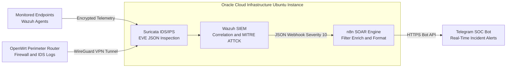

# Cloud-Hosted SOC & SOAR Automation Architecture on OCI

An end-to-end, self-hosted Security Operations Center (SOC) and Security Orchestration, Automation, and Response (SOAR) pipeline deployed on **Oracle Cloud Infrastructure (OCI)**. The stack combines **Wazuh SIEM** and **Suricata IDS/IPS** to monitor endpoint telemetry and remote OpenWrt perimeter firewall logs over encrypted **WireGuard** tunnels, automating alert enrichment and real-time **Telegram Bot** incident notifications via **n8n**.

---

## Architecture Overview



---

## Tech Stack

| Component | Technology | Role in Architecture |
| :--- | :--- | :--- |
| **Cloud Infrastructure** | Oracle Cloud Infrastructure (OCI) | Ubuntu Linux host running containerized security services |
| **SIEM & EDR Telemetry** | Wazuh (Manager, Indexer, Dashboard) | Centralized log correlation, FIM, and MITRE ATT&CK rule mapping |
| **Network IDS/IPS** | Suricata | Deep packet inspection and network intrusion signature detection |
| **SOAR Automation** | n8n | Webhook-driven alert parsing, severity filtering, and orchestration |
| **Perimeter Transport** | OpenWrt & WireGuard | Encrypted site-to-cloud transport for perimeter firewall logs |
| **Alert Delivery** | Telegram Bot API | Instant, structured push notifications for high-severity incidents |
| **Containerization** | Docker & Docker Compose | Service isolation, reproducible deployment, and resource control |

---

## Key Capabilities

* **Unified Host & Network Visibility:** Correlates endpoint process/authentication events from Wazuh agents with network-level intrusion alerts (`eve.json`) generated by Suricata.
* **Encrypted Perimeter Log Forwarding:** Streams remote OpenWrt router firewall and traffic logs into the OCI SIEM stack over a point-to-point WireGuard tunnel without exposing management ports publicly.
* **MITRE ATT&CK Detection Mapping:** Maps custom and built-in Wazuh correlation rules to MITRE ATT&CK tactics and techniques (e.g., Brute Force `T1110`, Valid Accounts `T1078`, Network Service Discovery `T1046`).
* **Automated SOAR Triage & Alerting:** Eliminates dashboard-watching delays by triggering an n8n webhook on high-severity alerts, extracting key Indicators of Compromise (source IP, agent hostname, rule ID, MITRE technique, severity level), and pushing a formatted incident card to Telegram.

---

## Automated Incident Alert Preview

When Wazuh triggers a rule at **Level 10 or higher**, the n8n SOAR workflow parses the JSON payload and dispatches a structured incident card to Telegram:

> 🚨 **[SOC ALERT - CRITICAL]**
>
> **Rule:** Critical SSH Brute Force Attack: 8+ failed login attempts from 203.0.113.45 (ID: 100103)  
> **Severity Level:** 12/15  
> **Agent / Sensor:** edge-gateway-01 (198.51.100.10)  
> **Source IP:** `203.0.113.45`  
> **Destination IP:** `198.51.100.10`  
> **MITRE ATT&CK:** T1110.001 (Credential Access)  
> **Timestamp:** 2026-11-19T16:10:00.000Z

---

## Repository Structure

```text
oci-wazuh-suricata-soar/
├── README.md                              # Project architecture & setup documentation
├── LICENSE                                # MIT License
├── docker-compose.yml                     # Sanitized multi-container deployment stack
├── .env.example                           # Environment variable template (no live secrets)
├── wazuh-telegram-soar-workflow.json      # Exported n8n SOAR automation workflow
├── .gitignore                             # Excludes live secrets, certificates & local volumes
└── config/
    ├── wazuh-custom-rules.xml             # Custom Suricata & OpenWrt MITRE ATT&CK rules
    └── ossec-integration-snippet.xml      # Wazuh-to-n8n webhook integration config
```

---

## Quick Deployment Guide

1. **Clone the repository:**
   ```bash
   git clone [https://github.com/zainn-007/oci-wazuh-suricata-soar.git](https://github.com/zainn-007/oci-wazuh-suricata-soar.git)
   cd oci-wazuh-suricata-soar
   ```
2. **Configure environment variables:**
   ```bash
   cp .env.example .env
   # Edit .env with your OCI host details, Wazuh credentials, and Telegram Bot token
   ```
3. **Launch the containerized stack:**
   ```bash
   docker compose up -d
   ```
4. **Import the SOAR workflow into n8n:**
   * Open the n8n web UI -> **Workflows** -> **Import from File** -> select `wazuh-telegram-soar-workflow.json`.
   * Attach your Telegram Bot credentials to the Telegram node and copy the generated Webhook URL into Wazuh's `<integration>` configuration block in `ossec.conf`.

---

## Author

**Zain Ul Abidin** — SOC Analyst | Cloud & Network Security  
[LinkedIn](https://www.linkedin.com/in/zain-ul-abidin-7577a8242)
